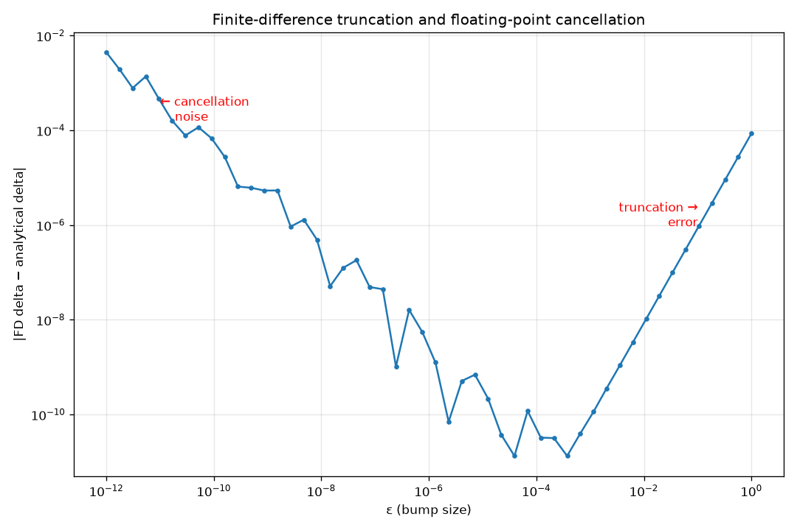

# Black–Scholes Greeks

Compare analytical, finite-difference and PyTorch-autograd sensitivities for vanilla European options.

**All 20 tests pass.** In the reproduced at-the-money call example, the largest autograd-versus-analytical error across the reported Greeks is 7.11 × 10⁻¹⁵; finite-difference theta differs by 0.00416.



## Quick start

From the repository root; all inputs are model parameters:

```bash
python3 -m venv .venv
.venv/bin/pip install -r requirements-dev.txt
.venv/bin/python -m pytest -q
```

`python -m src.compare` prints the methods side by side. `python -m src.make_figure` regenerates the charts from actual calculations. `python scripts/save_comparison.py` writes the explicit comparison inputs and results. No external market data, model weights or credentials are needed.

## Method

- Closed-form Black–Scholes prices and analytical delta, gamma, vega, theta and rho.
- Bump-and-reprice finite differences approximate the same derivatives.
- PyTorch differentiates the pricing expression, including a second derivative for gamma.
- Call and put tests compare methods and check basic limiting behavior.
- A bump-size sweep illustrates truncation and floating-point cancellation.

## Results

[Saved comparison](results/comparison.json): spot and strike 100, one-year maturity, rate 5% and volatility 20%.

| Greek | Analytical | Absolute finite-difference error |
|---|---:|---:|
| Delta | 0.636831 | 8.60 × 10⁻⁹ |
| Vega | 37.524035 | 3.04 × 10⁻⁵ |
| Theta | −6.414028 | 0.00416 |

These are controlled model checks, not calibrated market-risk estimates or a speed benchmark.

## What didn't work

Finite differences depend on bump size: large bumps introduce truncation error, while very small bumps lose precision through cancellation. Autograd agreement here does not validate every parameter regime or model. Stochastic-volatility, Monte Carlo pathwise Greeks and execution effects are not implemented. The earlier general efficiency claim lacked a benchmark and was removed.

## Tests, structure and licence

[](https://github.com/VChahar1/bs-greeks/actions/workflows/tests.yml)

`src/` contains formulas, differences, autograd and plotting; `tests/` contains cross-checks; `notebooks/01_bs_greeks.ipynb` retains its saved outputs. Code: [MIT](LICENSE).
